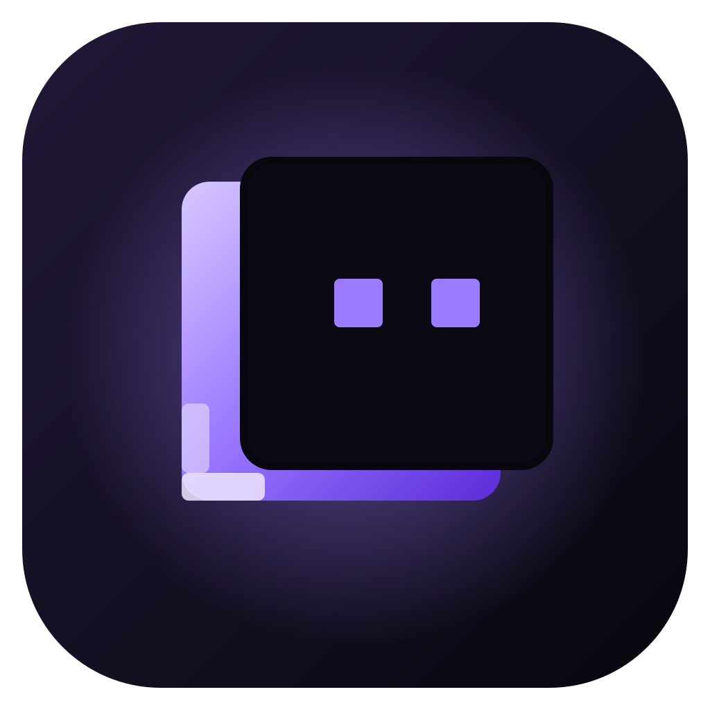

<p align="center"></p>

# Shadow Client

A lightweight Minecraft: Java Edition launcher for Windows 10/11, built to make the game as smooth as reasonably possible on integrated graphics, older CPUs and low-RAM laptops — with Modrinth/CurseForge mod management, automatic Sodium setup and honest performance tooling.

* **Tauri 2 + React** UI on the system WebView2 (small installer, low idle RAM) and a **Rust engine** (`crates/pc-core`) that does all the work.
* **No account of ours.** Profiles, mods and settings stay on your PC.
* **Nothing faked.** Download counts come from the APIs, compatibility is checked live, the benchmark measures real CPU/memory/disk speed and says it is not an FPS test, game RAM/CPU are measured from the process, and in-game FPS is not shown because the launcher can't read it.

> Not affiliated with Mojang Studios or Microsoft.

## Feature status

### Fully implemented (and covered by automated tests or verified on a real machine)

| Area | What works |
|---|---|
| Existing installs | Read-only scan of `%APPDATA%\.minecraft` (launcher profiles with their real `gameDir`, versions & loaders, mods, resource/shader packs, worlds, screenshots), extra folders, CurseForge/Prism/MultiMC/Modrinth App instances, Java runtimes. Manage in place or copy into an isolated instance. Never reads account files. |
| Profiles | Vanilla/Performance/PvP/Survival/Modded/Custom; own version, loader, mods, settings, game folder, Java, memory, JVM args, resolution. Rename, duplicate (worlds optional), export/import as `.mrpack`, delete with safeguards (worlds → `preserved-worlds`, rest → Recycle Bin, external folders untouched). |
| Navigation & search | Java Edition and Bedrock Edition tiles at the top of the sidebar; Play / Customize / Launcher groups below. **Ctrl+K** (or the search box) finds pages, profiles, installed mods, Bedrock modules and settings and opens the result already filtered; it can also search Modrinth. Settings has a section list, a search over every setting and a save bar that appears only with unsaved changes. Sliding highlights and short entrance animations, off when Windows asks for less motion. |
| Versions | Mojang manifest (releases, snapshots, old alpha/beta), rules, inheritance, legacy `minecraftArguments` and virtual/legacy assets, natives extraction, logging config. Fabric and Quilt installed automatically and pinned per profile. Repair = full re-verify. |
| Launching | Validate → files → mods → Java → account → first-run config → launch → supervise. Success only after the game's own log shows initialisation; early exits are reported with a diagnosis (Java too old, memory, mod resolution, Mixin, OpenGL driver…). Crash reports detected. Game RAM/CPU sampled every 2 s while running. |
| Java & memory | Per-version Java selection (Mojang runtime first), detection in registry/Program Files/official launcher/Store launcher/CurseForge/PATH, official Mojang runtime download (hash-verified). RAM recommendation by mod count, capped by installed RAM; validated JVM args; G1 (Mojang defaults), minimal or Generational ZGC presets. |
| Modrinth | Search (name/description/author, version, loader, categories, sort), project details (license, versions, environment), one-click install through the resolver, updates, hash identification of manual jars, cached + rate-limit aware with a proper User-Agent. |
| Resolver | Required/optional/incompatible deps, duplicates, version/loader mismatches (blocked with “available for …” and *create a matching profile*), known conflicts (renderer replacements etc.), jar metadata verified after download **before** anything is moved into `mods/`. |
| Mod management | Enable/disable, remove (to backups), restore previous version, update checks, warnings for missing deps/conflicts/duplicates/wrong MC version. |
| Automatic Sodium | Performance/PvP profiles get Sodium + compatible Lithium, FerriteCore, ImmediatelyFast, Entity Culling, Dynamic FPS (configurable); unavailable mods are skipped with an explanation and suggested versions. Performance Mods page with live availability and toggles. |
| Built-in mods | Marlow's Crystal Optimizer and Always Shield (MIT), embedded and hash-pinned for 1.21.11, resolved from Modrinth for other versions, never forced where no build exists. **Always on and not listed**: they are part of the client, so they don't appear in the launcher's mod list or in the in-game Mods screen (Mod Menu's `hidden_mods`), can't be disabled or removed, and PLAY re-enables/reinstalls them if their file was disabled or deleted. Always Shield is server-side logic: it takes effect in singleplayer/LAN worlds you host; on servers the server decides shield timing. |
| In-game features (Lunar-style) | Features page: the built-in Shadow Client mod menu (what it offers, at a glance), optional add-ons by other authors (old animations, minimap, world map), live per-version availability, overlap warnings, a warning with **Remove** when a profile still has AxolotlClient, and vanilla PvP options (toggle sprint/sneak, auto-jump, damage tilt, FOV/distortion effects) edited in options.txt with backups. New PvP profiles start with the default PvP HUD. |
| In-game client (Shadow Menu 2.0) | Shadow Client's own Fabric mod (source in `client-mod/`, MIT), built in for Minecraft 1.21.11 and hidden from mod lists; no AxolotlClient needed since 2.0. **Right Shift** (in game and on the title screen) opens a redesigned Lunar-style menu: categories, type-to-search, favourites, animated cards, and a settings page per module with switches, sliders, colour pickers (hue/saturation/alpha, chroma, presets, hex), choices, keybinds and text fields. **Client Settings**: Dark/Midnight/Black/Light theme, accent colour, card size, blur, animation speed. **HUD**: 22 movable modules drawn by the mod (FPS, CPS, keystrokes, ping, armor, potions, coordinates, compass, clock, speed, reach, combo, sprint status, memory, TPS, server address, pack display, arrow counter, scoreboard, boss bar, player model, Shadow HUD stack) with colour/chroma, background, border, text shadow and [brackets] options, and a **HUD editor** with dragging, snapping and guide lines, resizing by corner or scroll, nudging and right-click settings. **Native modules**: zoom, freelook, motion blur, custom crosshair, fullbright, time changer, block outline, hit colour, no hurt cam, low fire/shield, minimal view bob, no vignette, no rain, nametags, TNT timer, hide beacon beams, hit particles, scrollable tooltips, confirm disconnect, AutoGG/GLHF/Tip/Boop, Nick Hider, chat heads, saturation display, ping in tab, copy screenshots, and its own **Mods** list. Everything is Shadow Client's own: AxolotlClient, FancyMenu, Mod Menu, Chat Heads, AppleSkin and Better Ping Display are no longer installed (a profile that still has one gets a Remove prompt on the Features page). **Shadow Client title screen** built in (always on; replaces Minecraft's and any mod's title screen built on it). Kept from 1.x: Shadow HUD lines and PvP warnings, waypoints, Auto Text, kill tracking, hit/kill sounds, PvP alerts, Minecraft-option cards (FPS Boost, sound mixer, chat, mouse, …), the in-mod texture packs and the window title "Shadow Client 1.21.11". Profiles with an older menu jar get the current one (old file kept in the profile's backups). Details: `client-mod/README.md`. |
| Bedrock mod menu | Bedrock page → **Mod menu** tab, laid out like the in-game menu, with tabs Performance/PvP/Visual/HUD/Audio/Game/Privacy. Bedrock can't load mods, so its 89 cards are Bedrock's own settings for the account (VSync, max framerate, render distance, frame pacing, texel AA, upscaling, FOV, hurt cam, auto sprint, sensitivity, perspective, an 11-slider sound mixer, glint, distortion, HUD/chat opacity, GUI scale, UI profile, chat font, size, text and mention colours, subtitles, LAN/Xbox visibility, cross-play, …) and parts of a resource pack Shadow Client builds and switches on at the top of the account's global packs ("Shadow Client Modules": custom crosshair in 4 styles and 5 colours, no fire overlay, no pumpkin overlay, clean glass, clean stained glass, no weather effects, clear Nether portals, enchant glint colour, and the Shadow Background panorama). Refuses changes while Bedrock runs (it saves settings on exit); keeps options.txt as it was before the first change and the version before the last one; **Undo all** puts the settings back and switches the pack off (folder to backups). Picks the most recently played Xbox account; others can be chosen. Reading the menu was checked against the real install; changes were tested in temp folders only. |
| Shadow background | Shadow Client's own art (made by `client-mod/tools/PackGen.java`): a purple night sky with an eclipse, aurora, blocky hills and floating "shadow blocks". Used as the Java title-screen panorama (pack on by default), as the Bedrock menu panorama (Bedrock mod menu → Shadow Background) and as the launcher's default custom main menu background. |
| Servers page | Java servers saved in the launcher with live status from the game's own server list ping (MOTD, players, version, ping, icon) and **Join**, which starts the selected profile straight into the server (Quick Play on 1.20+, --server/--port before). Bedrock tab: Bedrock's own server list (external_servers.txt; add/remove with a backup, refused while Bedrock runs), RakNet ping, and Join through Bedrock's minecraft://connect link. No SRV lookups. Tested against local mock servers. |
| Screenshots | Each profile's screenshots in a grid (served through Tauri's asset protocol, allowed per folder), a viewer, open, and delete to backups. |
| Crash helper | When the game crashes, the message on Home names the likely cause from the crash report: the mod Fabric suspects, a mixin failure and its mod, out of memory, entity/world-generation/chunk problems, rendering; a native JVM crash names the graphics driver (NVIDIA/AMD/Intel) from hs_err_pid*.log. |
| Update notices | On start the launcher checks the newest GitHub release (`githubRepo` in branding.json, cached an hour) and shows a bar when it is newer than the running version. Installed copies update themselves: the setup.exe copy runs the new installer quietly, the MSI copy (since 0.4.0) runs the new MSI through Windows Installer; both reopen afterwards. Portable copies get the website. |
| Share links | Profiles → **Share** makes a link to the website's share page with the pack inside the link (name, Minecraft version, loader and the exact Modrinth/CurseForge versions of its mods, resource packs and shaders; deflate + base64url after `#`, nothing uploaded). The page lists the contents and has **Open in Shadow Client** (`shadowclient://share/…`, registered per user by installed copies, no admin); the launcher makes a new profile and shows the usual download plan (compatibility, dependencies, hash checks). Links can also be pasted in Profiles → **Add from share link**. Hand-added jars Modrinth doesn't recognise are listed as left out. |
| Add existing profile | Profiles → **Add existing profile** (and the first-start screen) copies a detected installation's mods, options and config into a new Shadow Client profile with the same name (worlds optional; logs, versions, libraries and other launcher files are skipped). The original folder is only read. Copied Fabric/Quilt profiles get the built-in mods; dependencies that came along as hand-copied jars (e.g. Fabric API) aren't downloaded again. |
| Bedrock worlds | Bedrock page → Worlds: each world with icon, size and last played; **Back up** zips it to a .mcworld in the launcher's backups (refused while Bedrock runs); **Restore** hands a backup to Bedrock, which imports it as a new copy. |
| Minecraft Bedrock | Bedrock page: detects the Microsoft Store/Xbox install and version, **PLAY BEDROCK** (starts it through Windows), lists resource/behavior/skin packs (incl. the nested and legacy layouts Bedrock's importer leaves), imports .mcpack/.mcaddon/.zip safely (no path traversal, size limits, same-uuid packs replaced with the old one in backups), hands .mcworld/.mctemplate to Bedrock's own importer, removes packs to backups, and browses/installs Bedrock add-ons and texture packs from CurseForge (needs the CurseForge API key; hash-checked downloads). Bedrock itself can't be modded or tuned by the launcher. |
| HUD mods & mod menu | Lunar-style chooser for the built-in HUD modules (FPS, CPS with optional right-click count, keystrokes, ping, armor, potions, coordinates, sprint status, reach, combo, speed, compass, clock, pack display, memory, TPS, arrow counter, scoreboard) with presets and a live preview; written to Shadow Menu's settings file (`config/shadowmenu.json`, backup first; positions, sizes and colours set in game are kept). New PvP profiles start with FPS, CPS, keystrokes, ping, armor and potions. In game, **Right Shift** → **Edit HUD** to drag, snap, resize and restyle them. |
| ShadowCombat (server plugin) | Toggleable Paper 26.3 plugin for a server you run (source in `server-plugin/`): hit delay 0–10 ticks, no attack cooldown (full hits; spear jabs/Lunge as fast as you click), no shield delay, master switch, per-player `/combat on|off`. The server decides these timings, so every client follows them; installed from Features → “Install on a server…”. Unit-tested; **not yet run on a live server**. |
| Hotkeys & input lag | Rebind the mod menu, zoom, freelook, fullbright, add waypoint, sprint, sneak, jump, offhand, drop, perspective and more by pressing the key or mouse button; written to options.txt like Options → Controls (backup first). Raw mouse input and VSync switches for lower input lag. |
| Title screen | Shadow Client's own title screen is part of the built-in mod (Shadow background panorama, logo, Singleplayer/Multiplayer/Shadow Menu/Options/Quit). The old FancyMenu-based custom main menu is no longer offered. |
| Skins | Skins tab with a local library and a pixel editor (pencil, eraser, fill, colour picker, palette, overlay layer, classic/slim, undo/redo, live front/back preview, original starter template), PNG import (legacy 64×32 converted) and export, copy a player's public skin by name. Use a skin locally in a profile (generated resource pack, works offline) or upload it to a Microsoft account via Mojang's official skin API. |
| Performance engine | Hardware detection (CPU, RAM, GPU + integrated/dedicated + driver + VRAM, display + refresh, OS, free disk), opt-in 5-second system benchmark with a deterministic preset recommendation, Low-end / Balanced / High FPS / Custom presets that write real `options.txt` keys (version-aware), preview of changes, backups before every change, restore original. |
| Modpacks | `.mrpack` and CurseForge zip import (path + host validation, hash checks, overrides, env filtering), install from Modrinth browse, update with backup that keeps worlds/options/servers, export. |
| Resource packs & shaders | List/activate (options.txt) /remove packs, browse+install; shader packs with Iris (offered automatically), activation via `iris.properties`, GPU warnings, never auto-enabled. |
| Downloads | HTTPS only, SHA-1/SHA-512 verification, `.part` + HTTP Range resume, bounded concurrency, cancel, retry, disk-space check, history. |
| Security | DPAPI-encrypted tokens/keys, redaction in logs/errors/diagnostics, no downloaded file executed, no admin rights. |
| Packaging | NSIS installer, MSI, portable zip (data next to exe), uninstall keeps worlds. Both installers update themselves. |

### Partially implemented

| Area | Status |
|---|---|
| Skin upload | Implemented against Mojang's official endpoint and tested for the offline-account refusal; real uploads need Microsoft sign-in (see below). |
| Microsoft sign-in | Device-code OAuth → Xbox → XSTS → Minecraft login → entitlement/profile check → DPAPI storage → refresh is implemented and tested against a mock server. **It needs an Azure client ID approved by Mojang** (none can be shipped; see docs/AUTH_SETUP.md). Until then use offline profiles (local testing) or the official launcher. |
| CurseForge | Search, install, dependency resolution, pack import and manual-download handling are implemented and tested with a mock API. **Requires your own API key** (docs/CURSEFORGE_SETUP.md); not exercised against the live API in this build because no key was available. |
| Forge / NeoForge | Not installed by the launcher (that requires running their installer). Existing installs made by the official installer can be managed and launched with an experimental switch. |
| Official launcher integration | Detect/open the launcher. **Open official launcher** (account window) and Profiles → **Register with official launcher** add Vanilla/Fabric/Quilt profiles the way the Fabric installer does (version JSON + one `launcher_profiles.json` entry, backup first; the newest 10 backups are kept). With Settings → General → **Only show the profile you open** (on by default) it is the only installation next to PLAY: the launcher's other installations move to `launcher_profiles.shadowclient-hidden.json` in the same folder (nothing deleted) and other Shadow Client entries are removed; turning the setting off and saving puts them back. Session reuse is **not** implemented (and not claimed). |
| Languages | English only (the setting exists and is validated). |

### Not available

* In-game FPS / frame-time readout (would need an in-game mod; the launcher says so instead of estimating).
* Code signing of the installer (builds are unsigned; SmartScreen may warn).

## Website

`website/` is the download page to share (no build step: plain HTML/CSS/JS with screenshots of the real app). `npm run website:serve` previews it at http://127.0.0.1:5190. `npm run website` copies the installer, MSI and portable zip into `website/downloads/` with stable names and writes `files.json` (version, sizes, SHA-256) that the page reads. Host the folder on any static host (GitHub Pages, Netlify, Cloudflare Pages); keep large downloads in GitHub Releases if the host limits file sizes, and point the download links there.

**Publishing a new version:** `npm run release -- <x.y.z>` does everything: bumps the version, runs the tests, builds the installers and portable zip, fills the checksums into `website/RELEASE_NOTES_<x.y.z>.md` (write the notes first; bullet lines also become the site's "What's new" entry), creates the GitHub release and pushes the website to GitHub Pages. Options: `--dry-run` (build only), `--skip-tests`. Launchers from 0.2.2 check for a new release every 15 minutes, show "Update needed" and update themselves with one click (setup.exe and MSI copies; portable copies get the website).

The client was renamed from Sunny Client: data in `%APPDATA%\SunnyClient` moves to `%APPDATA%\ShadowClient` on first start, `SUNNY_DATA_DIR` / `SUNNY_CURSEFORGE_API_KEY` still work, exports with the old profile file still import, the old skin pack name is switched off, and the server plugin (now ShadowCombat) copies SunnyCombat's settings once.

## Documentation

* [Share it with friends](docs/SHARING.md) · [Install guide](docs/INSTALL.md) · [Troubleshooting](docs/TROUBLESHOOTING.md) · [Security & privacy](docs/SECURITY_PRIVACY.md)
* [Microsoft sign-in setup](docs/AUTH_SETUP.md) · [CurseForge setup](docs/CURSEFORGE_SETUP.md)
* [Developer guide](docs/DEVELOPER.md) (exact build steps) · [Architecture](docs/ARCHITECTURE.md) · [Test report](docs/TEST_REPORT.md)
* [Third-party notices](THIRD_PARTY_NOTICES.md)

## Quick start (from source)

```bash
npm install
npm run app:dev       # development
npm run app:build     # installer + MSI
npm run portable      # portable zip
npm run website       # copy installers + checksums into website/downloads
```
